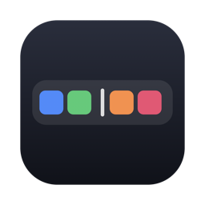
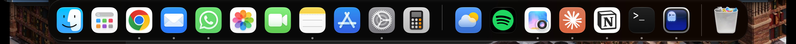
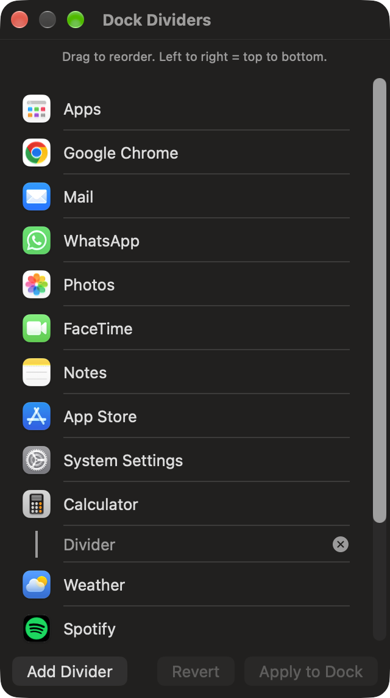

<p align="center">
  
</p>

<h1 align="center">Dock Dividers</h1>

<p align="center">
  Native-looking divider lines anywhere in the macOS Dock, so you can group your apps.<br>
  macOS Dock'un istediğin yerine native görünümlü ayraç çizgileri koyar, uygulamalarını gruplarsın.
</p>

<p align="center">
  <a href="https://dock-dividers.armanalis.workers.dev"><b>Website</b></a> ·
  <a href="#install--kurulum">Install</a> ·
  <a href="#how-it-works">How it works</a>
</p>

<p align="center">
  
</p>

<table>
  <tr>
    <td width="40%"></td>
    <td>
      <b>Drag to arrange</b> · English / Türkçe<br>
      Every Dock app and divider in one list. Drag a divider between any two apps, or drag an app between two dividers, then press <b>Apply to Dock</b>.<br><br>
      <b>Sürükle, sırala</b><br>
      Dock'taki tüm uygulamalar ve ayraçlar tek listede. Ayracı istediğin iki uygulamanın arasına, uygulamayı iki ayracın arasına sürükle, sonra <b>Dock'a Uygula</b>'ya bas.
    </td>
  </tr>
</table>

## Install / Kurulum

One command (macOS 13+, Apple Silicon and Intel):

```bash
curl -fsSL https://dock-dividers.armanalis.workers.dev/install.sh | sh
```

Or download [DockDividers.zip](https://dock-dividers.armanalis.workers.dev/DockDividers.zip) and drag the app to Applications.

Build from source (needs Xcode Command Line Tools):

```bash
git clone https://github.com/armanalis/dock-dividers.git
cd dock-dividers
./build.sh
open "/Applications/Dock Dividers.app"
```

Then allow it in **System Settings → Privacy & Security → Accessibility**. It needs this to read where the Dock's icons are.

Kurulumdan sonra **Sistem Ayarları → Gizlilik ve Güvenlik → Erişilebilirlik**'te izin ver. Dock ikonlarının yerini okumak için gerekli.

## How it works

1. **Add Divider** inserts Apple's own `small-spacer-tile` into the Dock: a half-icon-wide gap.
2. The app reads each spacer's position through the Accessibility API (`AXSpacerDockItem`).
3. A transparent, click-through window draws a thin line over each spacer, styled like the built-in separator and matching light/dark mode.

While a window is open it behaves like a normal app, with a Dock icon and menu bar; close it and only the menu bar icon (vertical line) stays. **Settings… (⌘,)** has Language (System / English / Türkçe), Open at Login and the Accessibility status.

## Limits

- Bottom Dock only; left/right Dock is not supported.
- Lines follow the Dock 3× per second, so they lag behind **Dock magnification**. Turn magnification off for a clean look.
- Rebuilding with an ad-hoc signature resets the Accessibility permission. `build.sh` uses a local code signing identity named `Dock Dividers Local Signing` if your keychain has one.

Deploy the website (Cloudflare Workers): `cd website && npx wrangler deploy`

## License

MIT
